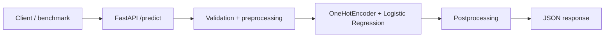

# P10 - IA as a Service avec FastAPI

Base reproductible pour étudier le passage d'un modèle léger à une API
d'inférence. Le cas d'usage actuel est la prédiction de la victoire de l'équipe
1 dans un match classé de Brawl Stars.

## Architecture



## Démarrage rapide

```powershell
python -m venv .venv
.\.venv\Scripts\Activate.ps1
pip install -r requirements.txt
uvicorn app.main:app --reload
```

Puis ouvrir `http://127.0.0.1:8000/docs`.

Les métriques cumulées du processus sont disponibles sur `GET /metrics` :

- nombre de requêtes `/predict` ;
- nombre d'erreurs de prédiction ;
- latence totale et moyenne du modèle.

## Préparer les données Brawl Stars

Le dépôt contient un petit échantillon de démarrage pour lancer l'API sans
télécharger plusieurs millions de lignes. Pour préparer un échantillon réel
depuis [EliF77/brawlstars-ranked](https://huggingface.co/datasets/EliF77/brawlstars-ranked),
lancer :

```powershell
python scripts/prepare_brawl_data.py --limit 100000
```

Le fichier généré est local. La variable `BRAWL_DATA_PATH` permet de choisir
un autre CSV préparé.

## Exemple de requête

```powershell
Invoke-RestMethod `
  -Uri http://127.0.0.1:8000/predict `
  -Method Post `
  -ContentType "application/json" `
  -Body '{"instances":[{"mode":"brawlBall","map":"Sneaky Fields","team_1_avg_elo":12.5,"team_2_avg_elo":11.0,"team_1_avg_power":11.0,"team_2_avg_power":11.0}]}'
```

## Benchmark

Avec l'API démarrée dans un terminal :

```powershell
python scripts/benchmark.py --url http://127.0.0.1:8000/predict --requests 200 --batch-sizes 1,4,16
```

Le script mesure :

- latence modèle seul ;
- latence HTTP bout-en-bout ;
- overhead du service ;
- throughput ;
- taux d'erreur ;
- CPU et mémoire du processus de benchmark.

Les résultats sont écrits dans `results/benchmark_*.csv`. Le rapport à compléter est dans `docs/rapport.md`.

## Reproductibilité

Les mesures doivent préciser la machine, le système, Python, les versions des dépendances, la taille de batch et le nombre de répétitions. Le script capture automatiquement une partie de ces informations dans `results/`.

## Structure

```text
app/
  main.py          API FastAPI
  brawl_model.py   modèle et preprocessing Brawl Stars
  model.py         baseline historique Iris
scripts/
  benchmark.py     charge et comparaison modèle/API
  prepare_brawl_data.py prépare un échantillon Hugging Face
data/
  brawlstars_ranked_sample.csv échantillon minimal de démarrage
docs/
  architecture.md  schéma et choix
  rapport.md       trame du rapport final
results/           CSV générés localement
```

## Limites de la base

Le CSV versionné est un échantillon pédagogique minimal. Il doit être
remplacé par un échantillon réel préparé avec `prepare_brawl_data.py` avant
toute analyse de performance ou de qualité. Les valeurs de benchmark sont à
produire sur votre machine ; elles ne doivent pas être inventées ni comparées
entre machines différentes.
