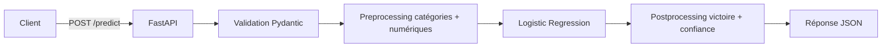

# Architecture cible

## Baseline Brawl Stars

- modèle : `ColumnTransformer` avec `OneHotEncoder` pour le mode et la carte,
  `StandardScaler` pour les agrégats numériques, puis `LogisticRegression` ;
- service : un processus Uvicorn, endpoint synchrone `/predict` ;
- données : lignes du dataset ranked Hugging Face, agrégées par équipe
  (Elo et niveau de pouvoir moyens) ;
- protocole : mêmes entrées, mêmes tailles de batch, répétitions identiques ;
- mesures : médiane, p95, throughput, erreurs et overhead API ;
- charge : exécution séquentielle par défaut, avec un niveau de concurrence
  configurable pour mesurer le throughput sous charge.

## Préparation des données

`python scripts/prepare_brawl_data.py --limit 100000` télécharge uniquement un
échantillon reproductible du split `season55` et produit le CSV consommé par le
modèle. Les noms des brawlers sont conservés dans le dataset source mais cette
première base ne les encode pas encore ; ils constituent une extension prévue
pour mesurer l'impact de la dimension catégorielle.

## Variantes à tester

Comparer la requête unitaire avec des batchs de 4 et 16, puis répéter la mesure
avec `--concurrency 4`. Le throughput est calculé sur le temps réel écoulé du
benchmark, et non sur la somme des latences individuelles. Les extensions
prioritaires sont l'ajout des six brawlers comme variables catégorielles, puis
la comparaison avec un modèle d'arbres, en gardant la machine et le protocole
constants.
